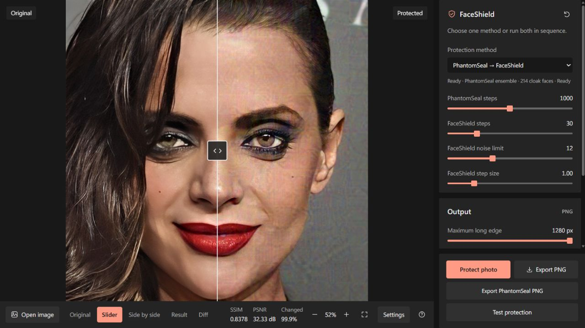

# FaceShield Studio

A local Windows editor for generating and inspecting experimental face-swap protection images. It combines the [FaceShield](https://github.com/kuai-lab/iccv25_faceshield) runtime with PhantomSeal's full four-branch identity objective, a comparison canvas, and an actual SimSwap test.

**Current evidence does not establish reliable face-swap protection.** Generating a perturbed PNG is a supported application feature; successful defense against a recognizable face swap is a separate question. Read the [validation record](docs/VALIDATION.md) before interpreting test scores.

This is a derivative of work by **Korea University Artificial Intelligence Computer Vision Lab (KUAICV), Department of Artificial Intelligence, Korea University — https://kuaicv.com/**. The original [KUAICV Research-Only License](LICENSE) and third-party terms apply. This repository is not licensed for unrestricted commercial use. Original project documentation is preserved in [UPSTREAM_README.md](docs/UPSTREAM_README.md).



Public demonstration image. The preview documents the interface and completed processing, not protection efficacy.

## What the application does

| Mode | Processing |
|---|---|
| PhantomSeal → FaceShield | Default: 1,000 PhantomSeal steps followed by 30 FaceShield steps |
| PhantomSeal only | Full 214-photo mixed cloak bank and all four identity/shape branches |
| FaceShield only | Adapted FaceShield diffusion, image-prompt and identity losses |

The editor preserves aspect ratio, caps the long edge at the selected size up to **1280 px**, and never enlarges smaller inputs. It optimizes changes at the output resolution. The costly analysis uses an aligned 256 px face view for PhantomSeal and a 512 px view for FaceShield's diffusion branch; this is not native 1280 px diffusion processing. No image resize occurs between the two stages.

The canvas supports an original view, slider, side-by-side view, result, and amplified pixel difference, with pan and zoom. PNG export saves the original in Original mode, the full-resolution difference map in Diff mode, and the protected image in the other modes. It does not export the comparison layout or viewport zoom. The intermediate PhantomSeal PNG has its own export action. SSIM, PSNR and changed-pixel measurements describe image changes, not defense success.

**Test protection** generates real unprotected and perturbed SimSwap outputs on a selected demo target, optionally after JPEG95 recompression. It tests the uploaded photo as an **identity source copied into another face**. It does not test preventing replacement of the uploaded photo's face when used as the destination.

## Windows setup

The supported local environment is Windows, Python **3.11**, and an NVIDIA GPU. The integrated path has been exercised on an **RTX 5070 Ti with 16 GB VRAM**. That is a tested configuration, not a minimum-memory guarantee for every input or setting. Node.js is optional for frontend regression tests; GNU Make is optional.

Run from the repository root in PowerShell:

```powershell
.\manage.cmd setup
.\manage.cmd models
```

`setup` creates or reuses `.venv`, installs PyTorch **2.7.1+cu128** and torchvision **0.22.1+cu128**, then installs the Windows dependencies. A compatible NVIDIA driver is required. It checks an existing environment before reinstalling and does not delete an incompatible virtual environment.

`models` downloads the public FaceShield base weights and the smaller SimSwap/ArcFace/FaceNet files. **It does not download PhantomSeal's full data and checkpoint archives.** Obtain and extract the official archives separately:

- [PhantomSeal data archive](https://drive.google.com/file/d/1feXBOP0WGemPMpsjeNLKe1j0l1A3Cxjj/view): the runtime uses `data/vggface2_cloak/mix_full`, containing 214 photos.
- [PhantomSeal checkpoint archive](https://drive.google.com/file/d/1p-_w1OMEYtph7R3yI188mE-o-xmJ6ya_/view): the runtime uses the SimSwap, FaceShifter and full HifiFace checkpoints described in [Development](docs/DEVELOPMENT.md#model-and-data-layout).

Keep the active resources together under **`weights/`**. From the extracted archives, place `faceshifter/model_ir_se50.pth` and `hififace/hififace_opensource_299999.ckpt` under the matching `weights/` subdirectories, and copy the complete `mix_full` bank into `weights/phantomseal/cloaks/mix_full/`. The small downloader supplies the SimSwap files. See the [complete placement table](weights/README.md) for every required file.

```powershell
.\manage.cmd configure -Checkpoints "weights" -Cloaks "weights\phantomseal\cloaks\mix_full"
.\manage.cmd doctor
.\manage.cmd run
```

Open **http://127.0.0.1:7876**. The server runs in the background and processes one GPU job at a time. `doctor` checks the environment, CUDA, required model files and full cloak bank without loading model weights; it does not test protection efficacy.

This repository defaults to **7876**, keeping it separate from the earlier installation on 7875. If 7876 is occupied, use another port:

```powershell
.\manage.cmd run -Port 7877
.\manage.cmd status -Port 7877
```

The manager refuses to adopt an unrelated process on an occupied port. To stop its own verified server:

```powershell
.\manage.cmd stop
```

Logs are in `.cache/manage/server.stdout.log` and `server.stderr.log`. A [Russian quick start](QUICKSTART.md) is also available.

If a complete local installation already exists, import its verified runtime assets instead of downloading them again:

```powershell
.\.venv\Scripts\python.exe scripts/import_local_assets.py --source "F:\Git\iccv25_faceshield"
.\manage.cmd doctor
```

The importer copies the selected model files and full 214-photo bank into **`weights/`**, records hashes under `weights/manifests/`, and writes relative configuration. It does not depend on symlinks or the old installation remaining in place, and does not import private editor results or the old virtual environment. Run `setup` first to prepare this repository's own environment. Add `--dry-run` to inspect the selection first; different existing destination files/configuration are rejected unless you explicitly request `--overwrite`.

For an existing **Studio** checkout using the previous scattered layout, stop its own server and preview the local migration before applying it:

```powershell
.\manage.cmd stop
.\.venv\Scripts\python.exe scripts/migrate_weights.py
.\.venv\Scripts\python.exe scripts/migrate_weights.py --apply
.\manage.cmd doctor
.\manage.cmd run
```

The first invocation is a plan only. `--apply` moves verified local resources into `weights/`; it does not move the virtual environment, generated results or files outside the project. See [the layout and migration notes](weights/README.md).

## Use and interpret the test

1. Upload a photo, choose a mode and settings, then run protection.
2. Inspect the final image and pixel difference. Export the final PNG or PhantomSeal intermediate as needed.
3. Select **Test protection**, choose one of three demo target faces, and run the SimSwap comparison.
4. For each condition, inspect **Unprotected swap** against your original photo. The default numerical baseline cutoff is 0.80. It is an adjustable quality gate, **not 80% confidence** or a calibrated identity threshold.
5. Confirm **The unprotected swap looks like me** only if it visibly retains your identity. Each condition starts unconfirmed. Weak or unconfirmed baselines remain **Inconclusive** and the comparative effect is hidden.

Raw images and scores remain available for inspection. A lower FaceNet cosine means less similarity under that evaluator; it does not give a success probability. Neither passing the baseline gate nor confirming likeness produces a “safe” verdict. The test uses one swapper, and SimSwap and FaceNet also participate in the protection pipeline.

## Checks and reproducible comparisons

```powershell
.\manage.cmd test
.\manage.cmd benchmark-help
.\manage.cmd benchmark
```

`test` runs CPU contract and regression checks, plus frontend checks when Node.js is installed. It does not run a GPU defense benchmark. The default benchmark uses six public source portraits, three targets and PNG/JPEG95 conditions: 36 paired comparisons and 108 generated swaps. It uses the GPU and saves JSON, CSV, HTML and a contact sheet. Do not run it concurrently with an editor job.

A smaller run, or a run against a server on another port:

```powershell
.\manage.cmd benchmark -Sources 1 -OutputDir "results\benchmarks\quick" -Port 7877
```

The current six-source evidence has only **8/36 comparisons passing the numerical baseline screen, from two source identities; those still require visual review**. The 1280 px supplement does not demonstrate reliable protection. The [validation record](docs/VALIDATION.md) includes the corrected interpretation and versioned measurements.

## Repository guide

- [Development and runtime architecture](docs/DEVELOPMENT.md)
- [Unified weights, data and manifests layout](weights/README.md)
- [Validation, baseline gates and limitations](docs/VALIDATION.md)
- [Component, model and data provenance](docs/PROVENANCE.md)
- [Implementation decisions from development](docs/DECISIONS.md)
- [Original FaceShield README](docs/UPSTREAM_README.md)
- [Detailed PhantomSeal integration notes](PHANTOMSEAL.md)

Active model weights, the full cloak bank, resource manifests and optional Hugging Face download caches live under `weights/`; only its README is tracked. Private uploads, generated editor results and the virtual environment remain separate ignored local assets. Preserve all upstream notices when copying or redistributing the code and obtain any permissions required by the component, model and data licenses.
